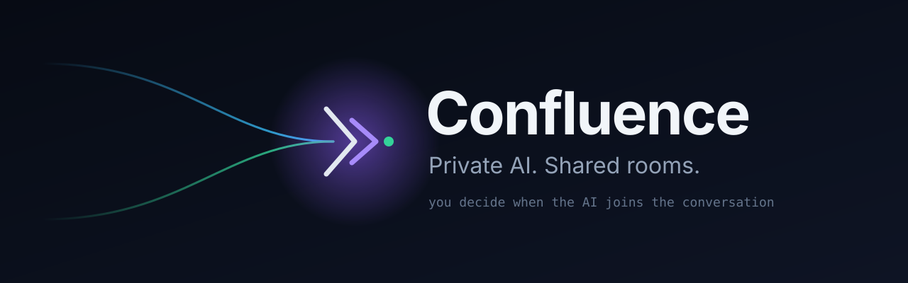
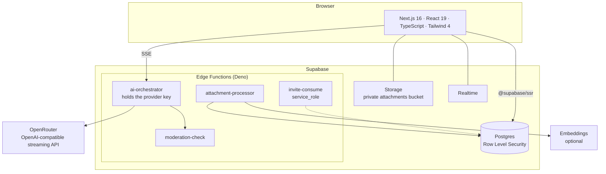
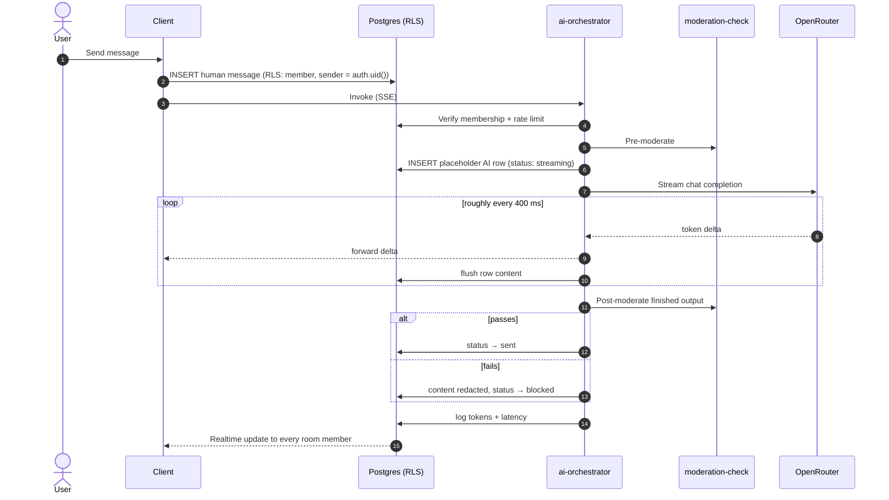
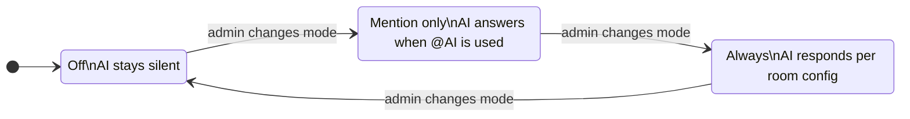

<div align="center">



<br/>

**Talk to AI privately. Bring it into a room only when you want it there.**

<br/>

[](https://group-chatbot-ruby.vercel.app/)
[](#changelog)
[](https://group-chatbot-ruby.vercel.app/)


[**Try it live**](https://group-chatbot-ruby.vercel.app/) ·
[Quick start](#-quick-start) ·
[How it works](#-how-it-works) ·
[Security](#-security-model) ·
[Attachments](#-attachments--ai-context) ·
[Testing](#-testing--quality) ·
[Deploy](#-deployment)

</div>

---

## The idea

Most AI products give you one of two things: a private assistant, or a bot bolted onto a group chat.

Confluence treats them as **one primitive**. A conversation can have one member or twenty, and a message can be written by a person or by the AI. Everything else (access control, streaming, moderation, realtime) follows from that decision.

| | Private AI | Shared rooms |
|---|---|---|
| **Who is in it** | You and Confluence AI | You, your teammates, and AI *if the room allows it* |
| **Visibility** | Isolated from everyone else | Visible to room members only |
| **AI behaviour** | Always responds | **Off**, **Mention only**, or **Always**, set per room |
| **Best for** | Focused thinking, drafts, questions | Planning, study groups, team decisions |

> Ask in private when you need focus. Invite the AI into the room when you need everyone on the same answer.

---

## ✦ Highlights

<table>
<tr>
<td width="50%" valign="top">

### 🔒 Private AI
Streaming answers, persistent history, and file context, in a conversation nobody else can read.

</td>
<td width="50%" valign="top">

### 👥 Shared rooms
Invite by link or code. Roles, room settings, and history are built in.

</td>
</tr>
<tr>
<td valign="top">

### 🎚 You control the AI
Per-room participation: **Off**, **Mention only** (`@AI`), or **Always**. The AI never speaks unless the room allows it.

</td>
<td valign="top">

### ⚡ Truly shared streaming
One message row is updated in place, so every member watches the same tokens arrive at the same moment.

</td>
</tr>
<tr>
<td valign="top">

### 📎 Grounded in your files
Documents become retrievable, member-scoped context, and citations are verified server-side.

</td>
<td valign="top">

### 🛡 Fail-closed by design
Row Level Security on every table. Moderation blocks on classifier *errors* instead of waving them through.

</td>
</tr>
<tr>
<td valign="top">

### 🧪 Demo mode
No environment variables? The app boots into a fully seeded in-browser experience with a simulated streaming assistant.

</td>
<td valign="top">

### 🎨 A real design system
Light and dark themes, semantic tokens, centralised motion, reduced-motion support, keyboard-first UX.

</td>
</tr>
</table>

---

## 🖼 Product tour

> **Add your screenshots here.** Drop images in `assets/screenshots/` and replace the placeholders below.

<!--
<p align="center">
  
  
</p>
<p align="center">
  
  
</p>
-->

The [live site](https://group-chatbot-ruby.vercel.app/) opens with an interactive preview showing private AI, shared rooms, AI participation, room members, typing indicators, and word-by-word streaming. The landing demo runs on deterministic local data. It illustrates the product and does not call the real AI backend.

---

## 🏗 How it works



**The AI provider key never reaches the browser.** The client calls `ai-orchestrator`, which streams back over SSE while progressively updating a single message row.

### Streaming lifecycle



Regenerating an answer reruns from the model call with `supersedes_id` set. The old answer becomes `superseded` and leaves the view **without being destroyed**.

### AI participation modes



---

## 📎 Attachments & AI context

Files shared in a conversation become **retrievable, member-scoped context** for the assistant.

```text
upload → validate → private bucket → message_attachments (queued)
      → attachment-processor: claim → download → extract → chunk → embed → persist → ready
      → ai-orchestrator: embed query → retrieve → fence into the prompt → cite
```

<details>
<summary><b>Processing lifecycle</b></summary>

<br/>

`unsupported → queued → processing → ready | failed`

- Jobs are claimed atomically, so concurrent calls cannot double-extract.
- A lease abandoned by a crashed function is reclaimable after 15 minutes.
- A failure clears partial chunks so a retry starts clean.
- A readable but empty document completes as `ready` with zero chunks. That is truthful, not a failure.
- The client chip polls a bounded number of times, announces each state, and offers **Retry**.

</details>

<details>
<summary><b>Extraction & chunking</b></summary>

<br/>

- Formats: PDF, plain text, Markdown, CSV, JSON, HTML.
- PDFs are extracted per page, so each chunk keeps the page it came from.
- Chunks are 1000 characters with 200 overlap, never crossing a page boundary, capped at 400 per attachment.
- A PDF that fails to parse **fails loudly**. No placeholder text is stored, because a placeholder could later be retrieved and cited as if the document said it.
- Uploads are capped at 10 MB. The allowlist deliberately excludes SVG.

</details>

<details>
<summary><b>Retrieval</b></summary>

<br/>

- **Hybrid** when embeddings exist (pgvector cosine + PostgreSQL full-text, fused by reciprocal rank).
- **Full-text only** when they don't. Degraded, never fabricated.
- Each retrieved chunk reports the method that actually found it: `hybrid`, `vector`, or `fts`.
- Retrieval is `SECURITY INVOKER` and re-checks membership itself. A non-member gets nothing back.
- Scope is the whole conversation, not just the recent-message window.

</details>

<details>
<summary><b>Prompt-injection & citation integrity</b></summary>

<br/>

- Extracted text is treated as untrusted data and delivered inside an explicitly delimited `SHARED FILE CONTENT` block. The matching system-prompt rules are added exactly when the block is.
- Citations are **derived, not trusted**. `buildVerifiedCitations` resolves whatever the model wrote against the chunks actually placed in the prompt and drops anything unresolvable.
- The client re-validates stored citations at the render boundary. No citation chip can be minted from model prose alone.

</details>

### Known limitations

Documented honestly, because a README that only lists strengths isn't useful:

- **Images are stored and displayed but not analysed by the model.** The provider layer currently carries text content only.
- **Audio and video are not transcribed** and are marked `unsupported`.
- **Semantic retrieval requires `OPENAI_API_KEY`.** Without it, retrieval is full-text.
- See [`ACCEPTANCE.md`](./ACCEPTANCE.md) for exactly what has and has not been verified.

---

## 🔐 Security model

| Concern | Enforcement |
|---|---|
| Who can read a conversation | RLS via `is_conversation_member()` on conversations, messages, reactions, and attachments |
| Who can administer a room | RLS via `is_conversation_admin()` (owner / admin only) |
| AI provider key | Lives only in Edge Function secrets. Never in client code |
| Service-role operations | Restricted to server contexts (e.g. `invite-consume`) |
| Invite redemption | Handled server-side; the client has no RLS path to an invite for a room it hasn't joined |
| Moderation | Two stages (pre + post). A classifier error **blocks** publication |
| Rate limiting | 30 msg/min and 20 invites/hr as `BEFORE INSERT` triggers; Edge counters for AI calls (10/min), moderation (60/min), attachment processing (20/min) |
| Attachments | Private bucket; storage policies reuse the membership check |
| Attachment chunks | Readable by members; **no client write policy**, so only `service_role` can write searchable text into a room |
| Training data | `profiles.training_opt_in`, off by default; routing requires **unanimous** opt-in |
| Redirects | `?next=` is collapsed to a same-origin path, so there are no open redirects |
| Secret scanning | gitleaks in CI |

> The client-side classifier in `src/lib/data/moderation-local.ts` is a **UX affordance only**. The authoritative check always runs server-side.

Security details and follow-ups live in [`SECURITY.md`](./SECURITY.md) and [`AUDIT.md`](./AUDIT.md).

---

## 🎨 Design system (v2.1)

Confluence v2.1 was a ground-up visual redesign: **premium modern SaaS with a restrained Apple / Linear feel.**

- **Tokens, not one-offs.** Semantic surface, text, accent, and AI-specific colours; spacing scale; radii; layered shadows.
- **Light and dark themes**, plus system.
- **Restrained glass.** Dense dialogs and forms use opaque elevated surfaces rather than heavy transparency.
- **One motion source of truth**: [`src/lib/motion.ts`](./src/lib/motion.ts). Transform and opacity only; exits are always faster than entries; `prefers-reduced-motion` collapses everything to an instant cut.
- **Self-hosted fonts** (Inter, JetBrains Mono). No request leaves for a font CDN.
- **Accessible by construction**: focus states, dialog semantics, radio semantics, keyboard navigation, command palette.
- **Responsive** from ~390 px mobile to ~1440 px desktop, with a collapsible sidebar and modals verified on narrow screens.

<details>
<summary><b>Interface inventory</b></summary>

<br/>

Landing page · authentication shell · application shell · sidebar · private conversation list · shared room list · chat interface · AI composer · new-conversation modal · group room creation · room settings · search · command palette · conversation actions · delete confirmations · theme switching · offline / error states · changelog

</details>

---

## 🚀 Quick start

**Requirements:** Node.js and npm. Deno is only needed for the Edge Function tests.

```bash
git clone https://github.com/Crusty-chirayu/Confluence.git
cd Confluence
npm install
npm run dev        # → http://localhost:3000
```

With **no environment variables**, Confluence boots into **demo mode**: seeded conversations, every screen, and a locally simulated streaming assistant. No backend required.

### Connect a real backend

<details>
<summary><b>Supabase + AI provider setup</b></summary>

<br/>

**1. Create a Supabase project** and apply the schema and migrations:

```bash
supabase db push
```

> `supabase_schema.sql` is the v2.0 baseline and does **not** include the attachment-understanding objects. Use `supabase db push`, or run the baseline and then every migration in filename order.

**2. Enable auth providers** in the Supabase dashboard (Email and Google).

**3. Set frontend variables:**

```bash
cp .env.example .env.local
```

| Variable | Where | Purpose |
|---|---|---|
| `NEXT_PUBLIC_SUPABASE_URL` | `.env.local` | Public Supabase project URL |
| `NEXT_PUBLIC_SUPABASE_ANON_KEY` | `.env.local` | Public anon key |

**4. Set server-only secrets** (via the Supabase CLI, never in `.env.local`):

| Secret | Required | Purpose |
|---|---|---|
| `OPENROUTER_API_KEY` | Yes | AI provider access (OpenRouter's OpenAI-compatible API) |
| `OPENAI_API_KEY` | Optional | Enables embeddings for hybrid (semantic + full-text) retrieval |
| `AI_MODEL` | Optional | Overrides the default model |
| `TRAINING_PIPELINE_URL` | Optional | Routing target after unanimous training-consent check |

```bash
supabase secrets set OPENROUTER_API_KEY=<your-key>
```

**5. Deploy the Edge Functions:**

```bash
supabase functions deploy ai-orchestrator attachment-processor moderation-check invite-consume
```

**6. Confirm RLS is enabled** on every table before going to production.

</details>

---

## 🧪 Testing & quality

```bash
npm test                 # Vitest: unit + component + a11y suites
npm run test:a11y        # axe-core accessibility suite (jsdom)
npm run test:contrast    # WCAG AA contrast against design tokens
npm run test:e2e:install # one-time: install Chromium
npm run test:e2e         # Playwright E2E + browser axe audit
npm run test:edge        # Deno: moderation fail-closed test
npm run test:pdf         # Deno: PDF extraction against real pdf.js
npm run lint
npx tsc --noEmit
npm run build
```

**Latest reported validation (v2.1):**

| Check | Result |
|---|---|
| Vitest | **270 / 270** passed (23 / 23 files) |
| TypeScript | 0 errors |
| ESLint | 0 errors |
| Production build | 14 / 14 routes |
| WCAG 2.2 AA contrast | 54 / 54 pairs |
| Axe accessibility | 0 violations |
| Production deployment | Healthy |

---

## 🗂 Project structure

```text
src/
├── app/                     App Router routes + self-hosted fonts
├── components/
│   ├── ui/                  primitives (button, input, modal, toast, avatar, skeleton)
│   ├── chat/                chat view, composer, message item, markdown, room settings
│   ├── layout/              sidebar, search / join / new-conversation modals
│   └── landing/             nav, interactive hero demo
└── lib/
    ├── motion.ts            motion tokens: single source of truth
    ├── data/api.ts          unified data layer (Supabase ⟷ demo)
    ├── data/demo-store.ts   in-browser stand-in for Supabase
    ├── attachments.ts       upload allowlist, size cap, storage paths
    ├── citations.ts         render-boundary citation validation
    └── supabase/            browser + server clients

supabase/
├── migrations/              versioned schema
└── functions/
    ├── ai-orchestrator/     streaming, moderation, retrieval, verified citations
    ├── attachment-processor/ extract → chunk → embed → persist
    ├── moderation-check/    fail-closed classifier
    ├── invite-consume/      invite redemption (service_role)
    └── _shared/             provider, extract, embeddings, citations, cors, ratelimit

e2e/                         Playwright suite
tests/                       Vitest + Deno integration tests
scripts/contrast.mjs         token contrast checker
```

> Layout summarised from the project documentation. Treat the repository tree as authoritative.

---

## 🌐 Deployment

| | |
|---|---|
| **Web app** | Vercel: [group-chatbot-ruby.vercel.app](https://group-chatbot-ruby.vercel.app/) |
| **Fallback** | Render: [group-chatbot.onrender.com](https://group-chatbot.onrender.com/) |
| **Backend** | Supabase (Postgres, Auth, Realtime, Storage, Edge Functions) |

CI (`ci.yml`) runs typecheck, lint, unit tests, build, `deno check`, the moderation fail-closed test, and a gitleaks scan. `release.yml` deploys in strict order: **migrations → Edge Functions → frontend**. Release steps are in [`RELEASING.md`](./RELEASING.md).

<details>
<summary><b>Current CI gaps</b></summary>

<br/>

The Playwright job, the contrast step, and `attachment-processor` are shipped as ready-to-apply patches under [`ci/patches/`](./ci/patches). Until applied, run those checks locally and deploy `attachment-processor` by hand.

</details>

---

## 📜 Changelog

**v2.1.0** — Visual redesign
- New design system: tokens, light/dark themes, restrained glass, elevated surfaces
- Confluence gateway brand mark across sidebar, landing, auth, AI identity, and modals
- Animated landing demo: typing indicator, word-by-word streaming, blinking cursor, dynamic status
- Modal layering and narrow-screen fit fixes
- Creator signature restored

**v2.0** — Unified conversation model, shared streaming, fail-closed moderation, RLS everywhere, demo mode

**V3 track** — Attachment understanding (see [above](#-attachments--ai-context) and [`ACCEPTANCE.md`](./ACCEPTANCE.md))

---

## 🤝 Contributing

Issues and pull requests are welcome. Before opening a PR:

```bash
npm run lint && npx tsc --noEmit && npm test && npm run build
```

---

<div align="center">

**Built by [Chirayu](https://github.com/Crusty-chirayu)**

<sub>Private AI. Shared rooms.</sub>

</div>
